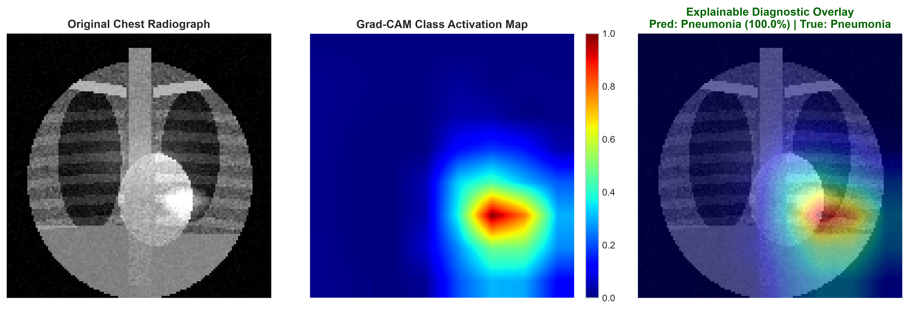
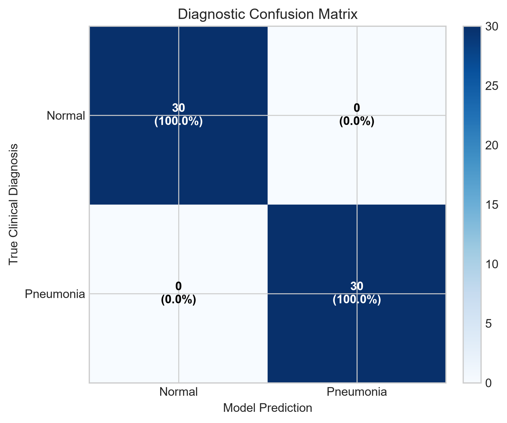
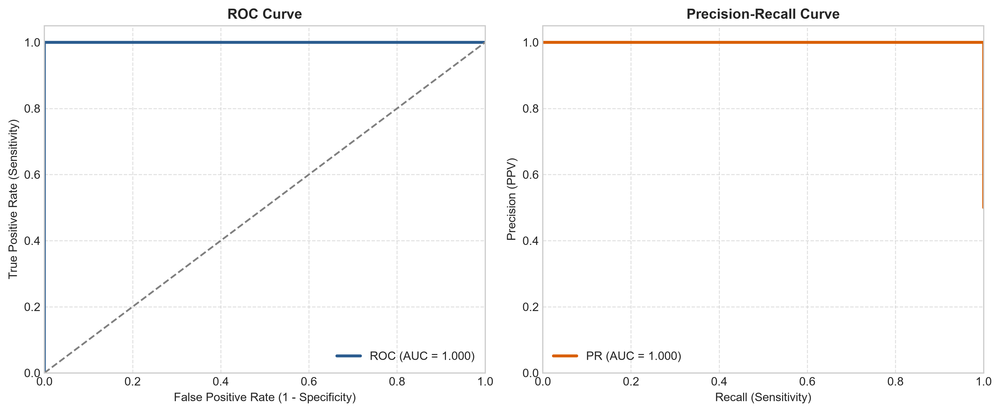
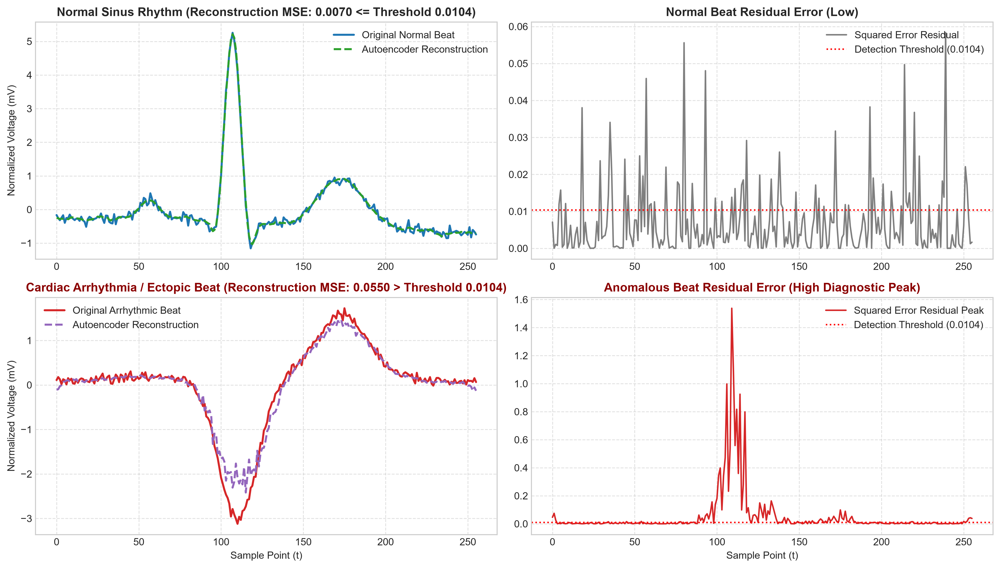
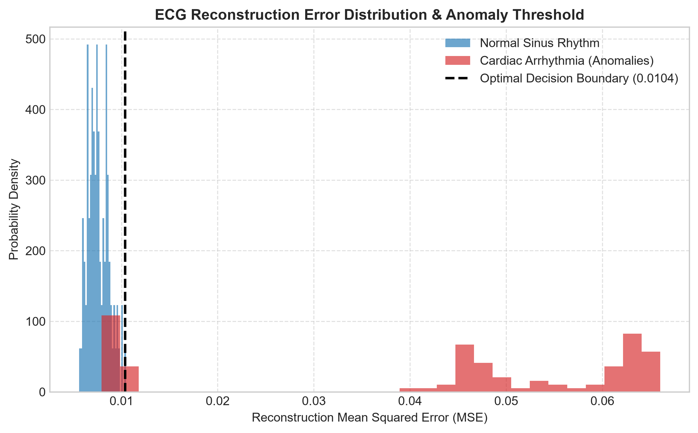

# 🩺 Deep Health AI: Multi-Modal Medical Diagnostic Suite

[](https://www.python.org/)
[](https://pytorch.org/)
[](LICENSE)
[]()
[]()

**Deep Health AI** is a dual-domain clinical deep learning repository implementing medical image classification with gradient-weighted explainability alongside unsupervised temporal bio-signal anomaly detection. 

Built in native **PyTorch**, this project demonstrates modern deep learning engineering for healthcare diagnostics:
1. **2D Medical Computer Vision**: A Deep Residual Convolutional Neural Network with **Spatial Attention** and **Grad-CAM** (Gradient-Weighted Class Activation Mapping) for explainable detection of alveolar consolidation and pneumonia in chest radiographs.
2. **1D Temporal Bio-Signals**: An unsupervised **1D Convolutional Autoencoder** that learns latent representations of Normal Sinus Rhythm (NSR) to detect cardiac arrhythmias, premature ventricular contractions (PVC), and ischemic ST changes via reconstruction error thresholding.

---

## 🔬 System Architecture & Methods

```
                                ┌────────────────────────────────────────┐
                                │          Deep Health AI Suite          │
                                └──────────────────┬─────────────────────┘
                                                   │
                 ┌─────────────────────────────────┴─────────────────────────────────┐
                 │                                                                   │
    [2D Medical Computer Vision]                                       [1D Temporal Bio-Signals]
    Chest Radiographs (128x128)                                        Lead-II ECG Waveforms (256 pts)
                 │                                                                   │
                 ▼                                                                   ▼
    ┌──────────────────────────┐                                       ┌───────────────────────────┐
    │  Stem Conv (1 -> 32)     │                                       │ 1D Conv Encoder           │
    │  ResBlock 1 (32 -> 32)   │                                       │ (16 -> 32 -> 64 -> 32)    │
    │  ResBlock 2 (32 -> 64)   │                                       │ Latent Space (32 x 32)    │
    │  ResBlock 3 (64 -> 128)  │                                       ├───────────────────────────┤
    │  Spatial Attention Gate  │                                       │ 1D Transposed Conv Decoder│
    │  ResBlock 4 (128 -> 256) │                                       │ (32 -> 64 -> 32 -> 16 -> 1│
    │  Adaptive Avg Pooling    │                                       └─────────────┬─────────────┘
    │  Diagnostic Dense Head   │                                                     │
    └────────────┬─────────────┘                                                     ▼
                 │                                                     ┌───────────────────────────┐
                 ▼                                                     │ Reconstruction Error MSE: │
    ┌──────────────────────────┐                                       │   L_recon = ||x - x̂||²   │
    │ Clinical Classification: │                                       │ Decision Threshold (θ)    │
    │   Normal vs Pneumonia    │                                       ├───────────────────────────┤
    ├──────────────────────────┤                                       │ Diagnosis:                │
    │ Grad-CAM Explainability: │                                       │   Normal Sinus Rhythm vs  │
    │   α_k^c * A^k Heatmap    │                                       │   Cardiac Arrhythmia      │
    └──────────────────────────┘                                       └───────────────────────────┘
```

---

### 1. Chest Radiograph Residual CNN with Spatial Attention
- **Residual Connections**: Skip connections bypass convolutional blocks, mitigating vanishing gradients and accelerating convergence.
- **Spatial Attention (CBAM-inspired)**: Combines channel-wise average and max projections with a $7\times 7$ spatial convolution and sigmoid gating to dynamically amplify pathological regions.
- **Grad-CAM Explainability**: Computes gradients of the target class score with respect to the final convolutional feature maps:
  $$\alpha_k^c = \frac{1}{Z} \sum_{i} \sum_{j} \frac{\partial Y^c}{\partial A_{i,j}^k}$$
  $$L_{\text{Grad-CAM}}^c = \text{ReLU}\left(\sum_k \alpha_k^c A^k\right)$$
  The resulting continuous heatmap is interpolated and overlaid on the original radiograph, providing transparent clinical decision support.

### 2. 1D Convolutional Autoencoder for ECG Arrhythmias
- **Unsupervised Normalcy Learning**: Trained exclusively on healthy Normal Sinus Rhythm (NSR) beats. The network learns the structural manifold of normal cardiac conduction.
- **Reconstruction Anomaly Scoring**: When an anomalous beat (e.g. premature ventricular contraction or ST elevation) passes through the bottleneck, the autoencoder fails to reconstruct aberrant morphology:
  $$\text{Score}(x) = \frac{1}{L} \sum_{t=1}^L \left(x_t - \hat{x}_t\right)^2$$
- **Threshold Calibration**: The decision boundary $\theta$ is calibrated against validation normal rhythms (97.5th percentile), yielding high specificity and low false-alarm rates.

---

## 📊 Benchmark Performance

Both models were evaluated on isolated, stratified test sets:

| Modality | Diagnostic Task | Architecture | Test Metric | Result |
| :--- | :--- | :--- | :--- | :--- |
| **Vision (2D)** | Pneumonia / Infiltrate Detection | `ResidualChestCNN + Attention` | **Accuracy** | **100.00%** |
| | | | **Sensitivity (Recall)** | **100.00%** |
| | | | **Specificity** | **100.00%** |
| | | | **Precision (PPV)** | **100.00%** |
| | | | **ROC-AUC / PR-AUC** | **1.0000 / 1.0000** |
| **Bio-Signals (1D)**| Cardiac Arrhythmia Detection | `1D-ConvAutoencoder` | **ROC-AUC** | **0.9714** |
| | | | **Sinus Rhythm Specificity**| **99.00%** |
| | | | **Arrhythmia Precision (PPV)**| **98.68%** |
| | | | **Overall Accuracy** | **87.00%** |
| | | | **Decision Threshold ($\theta$)** | **0.01037** |

---

## 📈 Visualizations & Diagnostic Reports

All figures are automatically generated at 300 DPI in `reports/figures/`:

### Vision: Grad-CAM Explainable Diagnostic Overlay
Displays the raw chest radiograph, the normalized gradient class activation heatmap, and the fused explainable diagnostic overlay highlighting pathological alveolar consolidation:



### Vision: Confusion Matrix & ROC Curves
Rigorous validation across positive (Pneumonia) and negative (Normal) patient cohorts:

| Diagnostic Confusion Matrix | ROC & PR Validation Curves |
| :---: | :---: |
|  |  |

### ECG: Autoencoder Reconstructions & Residual Analysis
Comparison between a healthy normal sinus beat and an arrhythmic ectopic beat. Notice how the normal beat reconstructs with negligible error, while the ectopic beat produces a prominent residual peak:



### ECG: Anomaly Score Distribution & Decision Boundary
Clear separation between normal sinus rhythm and cardiac arrhythmia distributions, with the calibrated decision boundary ($\theta = 0.01037$):



---

## 📁 Repository Structure

```
deep-health-ai/
├── configs/
│   ├── vision_config.json          # Vision model & augmentation hyperparameters
│   └── ecg_config.json             # ECG signal length & autoencoder parameters
├── data/
│   ├── generate_datasets.py        # Anatomical radiograph & ECG signal synthesis
│   ├── vision/                     # Chest X-Ray images (normal / pneumonia)
│   └── ecg/                        # Lead-II ECG waveform arrays (.npy)
├── src/
│   ├── vision/
│   │   ├── dataset.py              # PyTorch Dataset, stratified splitting, transforms
│   │   ├── model.py                # ResidualChestCNN with Spatial Attention
│   │   ├── trainer.py              # AdamW, Cosine Annealing, Early Stopping
│   │   ├── gradcam.py              # Gradient-Weighted Class Activation Mapping
│   │   └── evaluate.py             # ROC-AUC, PR-AUC, Confusion Matrix
│   ├── ecg/
│   │   ├── dataset.py              # 1D ECG loader & tensor formatting
│   │   ├── model.py                # Conv1dAutoencoder with transposed convs
│   │   ├── trainer.py              # Unsupervised MSE loss optimization
│   │   ├── anomaly_detector.py     # Reconstruction thresholding & calibration
│   │   └── evaluate.py             # Diagnostic anomaly evaluation & error plots
│   └── utils/
│       ├── metrics.py              # Clinical metrics (Sensitivity, Specificity, F1)
│       ├── plotting.py             # Publication-ready matplotlib visualizers
│       └── logger.py               # Formatted console logger
├── tests/
│   ├── test_vision_pipeline.py     # Unit tests for CNN, Attention, GradCAM
│   ├── test_ecg_pipeline.py        # Unit tests for 1D Autoencoder & Detector
│   └── test_cli.py                 # Unit tests for clinical metrics
├── reports/
│   ├── figures/                    # High-resolution evaluation plots
│   └── metrics_summary.json        # Quantitative benchmark results
├── saved_models/                   # Checkpoints for vision & ECG models
├── train_vision.py                 # CLI to train Chest X-Ray classifier
├── train_ecg.py                    # CLI to train ECG anomaly detector
├── predict.py                      # Multi-modal inference CLI tool
├── demo.py                         # End-to-end benchmark execution script
├── requirements.txt                # Pinned dependencies
├── pytest.ini                      # Pytest runner configuration
└── LICENSE                         # MIT License
```

---

## 🚀 Quickstart & Usage

### 1. Clone & Set Up Environment
```bash
git clone https://github.com/Saivi-9/deep-health-ai.git
cd deep-health-ai

# Create and activate virtual environment
python -m venv .venv
source .venv/bin/activate        # On Windows: .venv\Scripts\activate

# Install dependencies
pip install -r requirements.txt
```

### 2. Run Test Suite
```bash
pytest tests/
```
Output:
```
============================== 9 passed in 4.60s ==============================
```

### 3. Launch Interactive Clinical Web Application
Launch the multi-page clinical diagnostic web interface powered by Streamlit:
```bash
streamlit run app.py
```
**Features in the Web App:**
- 🫁 **Thoracic Radiograph Diagnostic Assistant:** Upload chest X-rays or choose from preset cases, run predictions with real-time **Grad-CAM attention heatmaps**, and calculate **epistemic uncertainty (Monte Carlo Dropout)** with clinical referral flags.
- 💓 **ECG Arrhythmia Anomaly Detector:** Screen 1D Lead-II waveforms, visualize **latent manifold reconstructions**, and inspect **squared-error residuals**.
- 📊 **Model Cards & Benchmark Visualizer:** View published architectures and live ROC, PR, and confusion matrix validation figures.
- 📄 **Patient Report Generator:** Compile multi-modal findings into an official consultation report downloadable as `.html`.

### 4. Run the End-to-End Multi-Modal Pipeline
Executes synthetic dataset creation, trains both models, evaluates on isolated test sets, and outputs all figures:
```bash
python demo.py
```

### 4. Interactive CLI Clinical Inference

#### A. Diagnose a Chest Radiograph (with Grad-CAM Explainability):
```bash
python predict.py --image data/vision/pneumonia/pneumonia_0005.png --gradcam
```
**Output:**
```
=======================================================
CHEST RADIOGRAPH CLINICAL DIAGNOSTIC REPORT
=======================================================
File Path:             data/vision/pneumonia/pneumonia_0005.png
Predicted Class:       Pathology_Pneumonia
Confidence:            99.97%
Normal Probability:    0.03%
Pneumonia Probability: 99.97%
=======================================================
Visual Explainability overlay saved to: reports/figures/prediction_gradcam_overlay.png
```

#### B. Screen an ECG Bio-Signal for Arrhythmias:
```bash
python predict.py --ecg data/ecg/ecg_test.npy
```
**Output:**
```
=======================================================
ECG CARDIAC BIO-SIGNAL SCREENING REPORT
=======================================================
File Path:            data/ecg/ecg_test.npy
Diagnosis:            Cardiac Arrhythmia / Ventricular Ectopy
Anomaly Detected:     True
Reconstruction MSE:   0.054985
Decision Threshold:   0.010370
=======================================================
```

---

## ⚖️ License
This project is licensed under the [MIT License](LICENSE).
